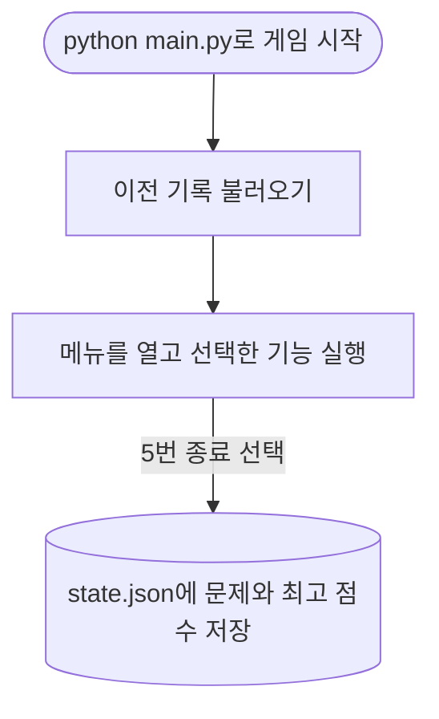
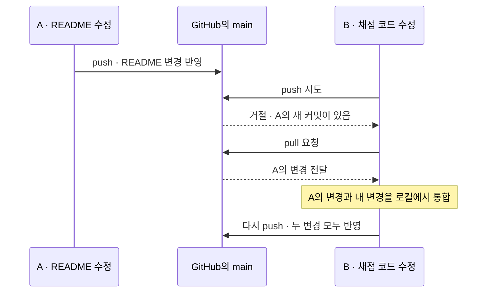
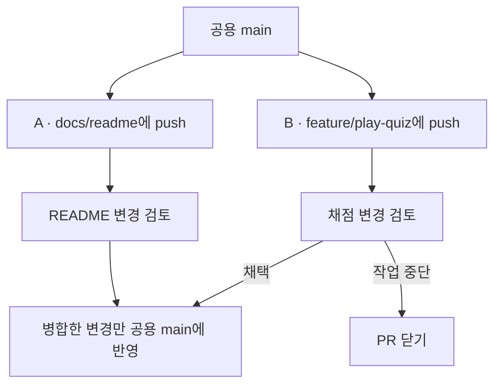

# 상식 퀴즈 게임

터미널에서 상식 문제를 풀고, 직접 만든 문제를 추가할 수 있는 파이썬 게임입니다. 처음 실행하면 기본 문제 5개로 시작합니다. 한 판을 마치면 100점 기준으로 점수를 보여주고, 게임을 종료하면 퀴즈 목록과 최고 점수를 저장합니다.

## 퀴즈 주제와 선정 이유

**주제는 상식 퀴즈입니다.** 최근 궁금한 상식을 찾아보다가 유튜브에서 관련 영상을 재미있게 봤습니다. 영상에서 본 것처럼 여러 분야의 상식을 문제로 만들어 직접 풀어보고 싶었습니다. 기본 문제에는 스포츠, 한글, 지리, 역사, AI 관련 상식을 담았습니다.

## 실행 방법

1. **Python 3.10 이상**을 준비합니다. 별도로 설치할 파이썬 라이브러리는 없습니다.
2. 터미널에서 `main.py`가 있는 프로젝트 폴더를 엽니다.
3. 아래 명령을 실행합니다. 메뉴가 나오면 원하는 번호를 입력하고 Enter를 누릅니다.

```powershell
python main.py
```

## 기능 목록

| 메뉴 | 할 수 있는 일 |
| --- | --- |
| **1. 퀴즈 풀기** | 등록된 문제를 한 판에 한 번씩 풉니다. 답을 고를 때마다 맞았는지 알려주고, 마지막에 맞힌 개수와 100점 기준 점수를 보여줍니다. |
| **2. 퀴즈 추가** | 문제 문장, 선택지 4개, 정답 번호를 입력해 새 문제를 등록합니다. |
| **3. 퀴즈 목록** | 등록된 문제 수와 문제 제목을 확인합니다. |
| **4. 점수 확인** | 지금까지 완료한 판의 최고 점수를 확인합니다. 첫 판을 마치기 전에는 기록이 없다고 안내합니다. |
| **5. 종료** | 게임을 끝내고 현재 퀴즈 목록과 최고 점수를 저장합니다. |

- **보너스 기능인 랜덤 출제**는 판을 시작할 때 문제 순서를 섞습니다. 목록 메뉴에서는 등록한 순서로 문제를 볼 수 있습니다.
- 번호를 입력할 때 앞뒤 공백은 무시합니다. 빈 입력, 문자, 범위를 벗어난 번호를 넣으면 다시 물어봅니다. 문제 문장과 선택지도 비워 둘 수 없습니다.
- 입력 중 `Ctrl+C`를 누르거나 입력이 끝나면 종료를 안내하고, 그때까지의 기록을 저장하려고 시도합니다.

## 파일 구조

| 파일 또는 폴더 | 역할 |
| --- | --- |
| `main.py` | 메뉴, 문제 출제와 채점, 문제 추가, 최고 점수 관리, 저장 기능이 들어 있는 실행 파일 |
| `state.json` | 게임을 종료할 때 생성하거나 갱신하는 저장 파일 |
| `README.md` | 프로젝트 소개와 실행 안내 |
| `.gitignore` | 개인 기록이 담긴 `state.json` 등을 Git 추적 대상에서 제외하는 설정 |
| [docs/screenshots](docs/screenshots/) | 개발 환경, 퀴즈 추가·목록·플레이·점수 확인, Git 이력 캡처 |

## 데이터 파일 설명

**`state.json`**은 프로젝트의 맨 바깥 폴더, 즉 `main.py`와 같은 폴더에 있습니다. 퀴즈 목록 전체와 최고 점수를 UTF-8로 저장하고, 다음 실행에서 다시 읽습니다. 파일이 없으면 기본 문제 5개로 시작합니다. 파일을 읽을 수 없거나 형식이 올바르지 않으면 안내를 출력하고 기본 상태로 시작합니다.

| 항목 | 저장하는 값 |
| --- | --- |
| `quizzes` | 등록된 문제 목록 |
| `question` | 문제 한 개의 문장 |
| `choices` | 문제 한 개의 선택지 4개 |
| `answer` | 정답이 몇 번째 선택지인지 나타내는 번호. 1부터 4까지 사용합니다. |
| `best_score` | 0~100점 사이의 최고 점수. 한 판도 마치지 않았다면 `null`로 저장합니다. |

아래는 구조를 보여주기 위해 문제를 하나만 담은 예시입니다. `"answer": 1`은 첫 번째 선택지가 정답이라는 뜻입니다.

```json
{
  "quizzes": [
    {
      "question": "한글 ㅎ의 이름은?",
      "choices": ["히읗", "히읕", "히읃", "히읏"],
      "answer": 1
    }
  ],
  "best_score": 80.0
}
```

## 코드 구조

### 게임을 켜면 어떤 순서로 실행되나요?



이전 기록이 없으면 기본 문제 5개로 시작합니다. 메뉴에서 1~4번을 선택하면 해당 기능을 실행한 뒤 다시 메뉴를 보여줍니다.

### 메뉴에서 1번을 누르면 어떤 코드가 실행되나요?

1. **번호 받기** · `read_number()`가 메뉴 번호를 확인합니다. `abc`나 `9`를 입력하면 다시 물어봅니다.
2. **퀴즈 시작** · `QuizGame`의 `play_quiz()`가 문제 순서를 섞고 한 문제씩 꺼냅니다. `QuizGame`은 메뉴, 문제 목록, 최고 점수까지 관리하는 클래스입니다.
3. **문제 보여주고 채점하기** · `Quiz`는 문제 문장, 선택지 4개, 정답 번호를 담는 클래스입니다. `show()`가 문제를 보여주고, `is_correct()`가 입력한 번호를 채점합니다.
4. **결과 확인** · 예를 들어 5문제 중 4개를 맞히면 80점이 나옵니다. `QuizGame`은 이번 점수를 최고 점수와 비교한 뒤 메뉴로 돌아갑니다.

첫 저장이 성공하면 `main.py` 옆에 `state.json`이 생깁니다. 입력 도중 `Ctrl+C`를 눌렀을 때도 그때까지의 기록을 저장하려고 시도합니다.

## 이번 과제에서 제가 중요하게 본 점들

### 커밋 메시지에 변경의 종류를 적었습니다

커밋은 변경 내용을 한 묶음으로 저장한 기록입니다. 저는 커밋 메시지를 `종류: 무엇을 바꿨는지` 형식으로 적었습니다. 팀원이 이력을 볼 때 맨 앞의 단어로 어떤 작업인지 파악하고, 뒤의 설명으로 구체적으로 무엇이 달라졌는지 알 수 있습니다.

| 표시 | 뜻과 쓰는 상황 | 예시 |
| --- | --- | --- |
| `Feat` | **Feature(기능)**. 사용자가 새로 할 수 있는 일이 생겼을 때 씁니다. | `Feat: 퀴즈 추가와 입력 검증 구현` |
| `Fix` | **고치다**. 원래 동작해야 하는 기능의 오류를 수정했을 때 씁니다. | `Fix: 정답 번호 0을 입력하면 다시 묻도록 수정` (설명용 예시) |
| `Chore` | **일상적인 작업**. 저장소 초기 설정처럼 개발을 준비하거나 유지하는 작업에 씁니다. | `Chore: 프로젝트 초기 설정` |
| `Docs` | **Documentation(문서)**. README의 실행 안내처럼 사용하거나 개발하는 방법을 문서에 추가하거나 고칠 때 씁니다. | `Docs: 실행 방법과 저장 파일 구조 설명` |
| `Refactor` | **코드 구조 개선**. 사용자가 보는 기능을 유지하면서 코드의 역할을 나누거나 구조를 정리할 때 씁니다. | `Refactor: QuizGame으로 게임 상태와 기능 정리` |

예를 들어 퀴즈 추가 기능을 붙이는 작업과 README의 실행 방법을 고치는 작업은 각각 커밋할 수 있습니다. 그러면 팀원이 퀴즈 추가 동작을 검토할 때 관련 변경만 열어볼 수 있고, 나중에 문제가 생겨도 어느 변경부터 살펴볼지 찾기 쉽습니다. 접두어와 대소문자는 팀에서 정한 규칙을 따릅니다. [Conventional Commits](https://www.conventionalcommits.org/en/v1.0.0/)

### 새 기능을 브랜치에서 작업한 뒤 합쳤습니다

브랜치는 같은 프로젝트에서 **작업 이력을 따로 쌓을 수 있는 갈래**입니다. 이번 과제에서는 `main`에 메뉴와 기본 문제가 있는 상태에서 `feature/play-quiz` 브랜치를 만들었습니다. 그곳에서 문제 출제, 채점, 결과 표시를 구현한 뒤 `main`에 병합했습니다. 병합은 브랜치에서 만든 변경을 합치는 작업입니다.

팀에서 이렇게 작업하면 새 기능을 만드는 동안에도 팀원은 `main`의 기존 버전으로 다른 일을 이어갈 수 있습니다. 기능이 준비되면 GitHub에서 풀 리퀘스트(PR)를 열어 **무엇이 바뀌었는지 보여주고 동료에게 검토를 요청**할 수 있습니다. 예를 들어 이번 퀴즈 풀기 기능이라면, 정답과 오답이 제대로 표시되는지, 마지막 점수가 맞는지 확인한 뒤 합치는 흐름입니다. [Pro Git의 브랜치와 병합](https://git-scm.com/book/en/v2/Git-Branching-Basic-Branching-and-Merging)

그 과정에서 브랜치의 장점이 더 분명해집니다. 예를 들어 채점이 틀리면 검토자가 PR에 **수정을 요청**하고, 작성자는 같은 브랜치에서 고쳐 다시 검토받을 수 있습니다. 팀이 기능을 도입하지 않기로 하면, 팀장이나 담당자는 **병합 없이 PR을 닫고**, 필요한 권한이 있다면 작업 브랜치도 정리할 수 있습니다. 병합 전까지 변경은 작업 브랜치에 있으므로, 기능을 접어도 `main`에서 되돌릴 작업이 없습니다. 이미 병합했다면 `main`에서 해당 변경을 되돌리는 작업이 따로 필요합니다. [GitHub의 PR 닫기 안내](https://docs.github.com/en/pull-requests/how-tos/merge-and-close-pull-requests/closing-a-pull-request)

### 같은 브랜치에서 작업할 때와 기능별로 나눌 때

두 방식 모두 각자 수정한 내용을 `git add`로 골라 `git commit`으로 **자기 컴퓨터에 먼저 기록**할 수 있습니다. 아래에서는 A가 README를 고치고, B가 퀴즈 채점 코드를 고친다고 가정했습니다.

#### 방법 1. 둘 다 `main`에 올리기



B가 아직 A의 커밋을 가져오지 않은 경우입니다. 예를 들어 `git pull --rebase`를 쓰면 A의 커밋을 먼저 가져온 뒤 그 위에 B의 커밋을 다시 적용합니다. 이처럼 서로 다른 파일을 고친 경우에는 보통 충돌 없이 진행됩니다.

#### 방법 2. 각자 작업 브랜치에 올리기



| 비교할 점 | 같은 `main`에서 작업 | 기능별 브랜치에서 작업 |
| --- | --- | --- |
| 팀원이 먼저 올렸다면 | 내 `main`에 팀원 변경을 가져온 뒤 다시 올립니다. | 각자 자기 브랜치에 올립니다. 필요하면 병합 전에 최신 `main`의 변경을 작업 브랜치에 가져옵니다. |
| 공용 `main`에 들어가는 시점 | `main`으로의 푸시가 성공할 때 | 검토 후 작업 브랜치의 변경을 병합할 때 |
| 채점 변경을 보류하기로 했다면 | 이미 `main`에 올라간 변경을 빼려면 되돌리는 커밋이 필요합니다. | 병합 전이면 PR을 닫거나 보류할 수 있습니다. |

두 사람이 같은 줄을 서로 다르게 바꾸면 **두 방식 모두 변경을 합칠 때 충돌**할 수 있습니다. 이번 과제에서 제가 브랜치를 써 본 이유는 **작업을 공유하는 시점과 그 작업을 `main`에 반영하는 시점을 따로 정할 수 있어서**입니다. [Pro Git의 브랜치와 병합](https://git-scm.com/book/en/v2/Git-Branching-Basic-Branching-and-Merging)
